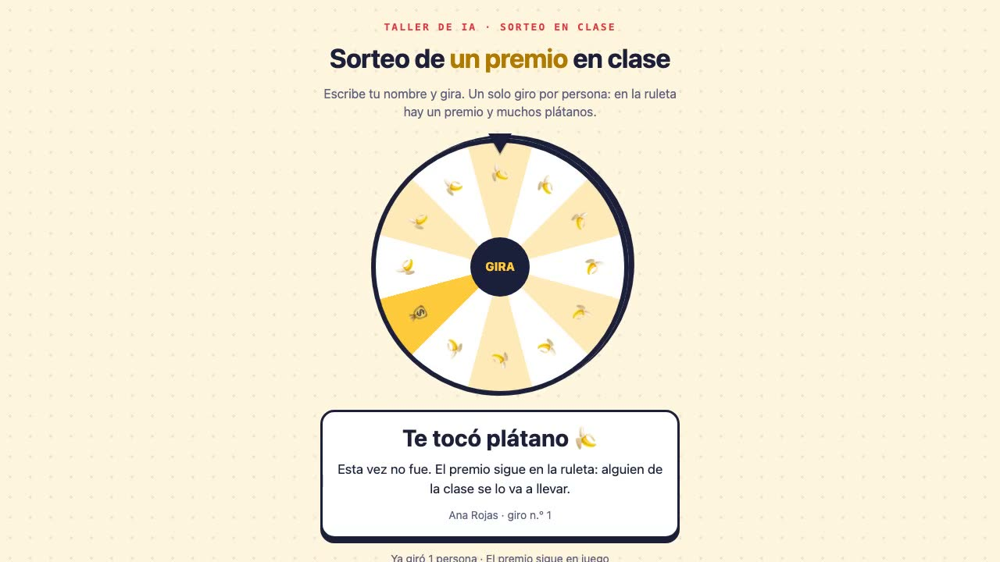
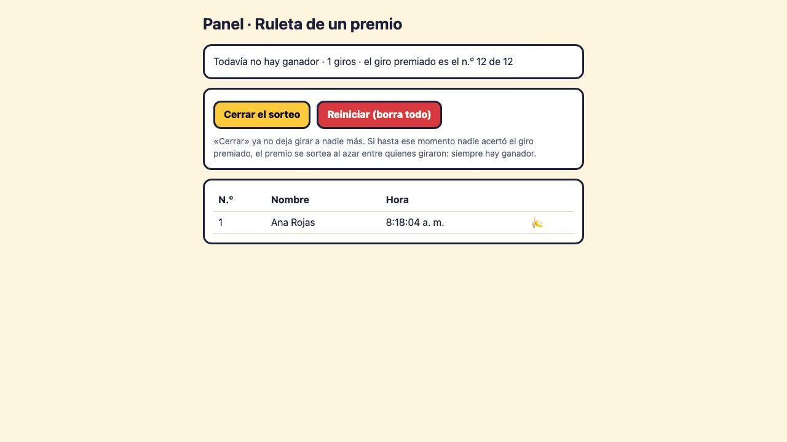

# Ruleta de un premio

Una ruleta de 12 casillas con un solo premio. El giro ganador se elige al azar cuando se crea el sorteo, así que nadie sabe cuál es. Cada persona gira una vez. Si al cerrar nadie acertó, el panel sortea el premio entre quienes giraron: siempre hay ganador.



## Cómo levantarlo (Windows y Mac)

Con Docker Desktop abierto, en esta carpeta:

```bash
docker compose up -d --build
```

- El sorteo: **http://127.0.0.1:8101**
- El panel: **http://127.0.0.1:8101/admin?k=TU_CLAVE**. La clave de ejemplo es `cambia-esta-clave-larga`.
- Para apagarlo: `docker compose down`. Para borrar también los participantes: `docker compose down -v`.

Para usar tu propia clave, copia `.env.example` como `.env` y cámbiala (mínimo 12 caracteres). En
Windows: `copy .env.example .env`; en Mac: `cp .env.example .env`.

## Qué enseña

- **Azar en el servidor:** el número del giro premiado sale de `crypto/rand` y nunca viaja a la página.
- **Una vez por persona:** por nombre y por navegador (una cookie). Es un control suave, pensado para una clase presencial o por Zoom.
- **Siempre hay ganador:** «Cerrar el sorteo» elige entre quienes giraron.



## Hazlo tuyo

Si cambias `SORTEO_TOTAL` en el `.env`, cambia también `N` en `web/index.html`: la página dibuja esa cantidad de casillas.

El prompt que crea este ejemplo está en [PROMPT.md](PROMPT.md).
