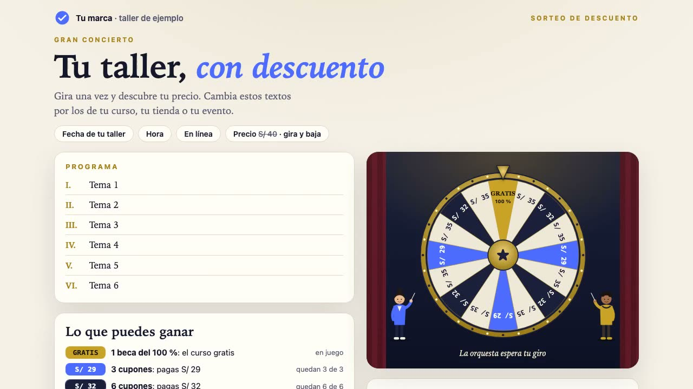
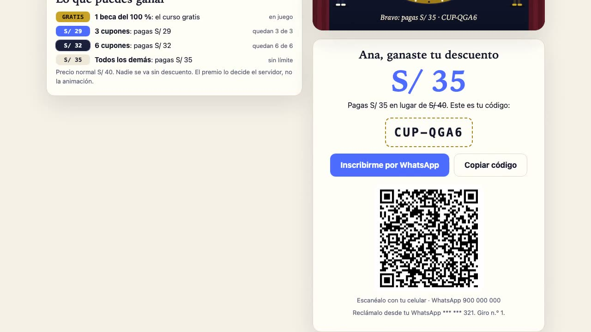

# Ruleta con cupos limitados

Una ruleta de descuentos donde nadie se va sin premio, pero los premios grandes son pocos: 1 beca del 100 %, 3 cupones de S/ 29, 6 de S/ 32 y S/ 35 para todos los demás. Cuando se acaba un premio, sale de la ruleta. Al ganar, la persona ve su código, un botón de WhatsApp con el mensaje ya escrito y un QR.



## Cómo levantarlo (Windows y Mac)

Con Docker Desktop abierto, en esta carpeta:

```bash
docker compose up -d --build
```

- El sorteo: **http://127.0.0.1:8102**
- El panel: **http://127.0.0.1:8102/admin?k=TU_CLAVE**. La clave de ejemplo es `cambia-esta-clave-larga`.
- Para apagarlo: `docker compose down`. Para borrar también los participantes: `docker compose down -v`.

Para usar tu propia clave, copia `.env.example` como `.env` y cámbiala (mínimo 12 caracteres). En
Windows: `copy .env.example .env`; en Mac: `cp .env.example .env`.

## Qué enseña

- **Cupos con tope:** el servidor lleva la cuenta y no entrega más de lo que dice el stock.
- **Una vez por número:** el WhatsApp de 9 dígitos es la llave; si alguien repite, el servidor lo rechaza.
- **Cierre automático:** la fecha de `SORTEO_CIERRE` apaga el sorteo y la página muestra la cuenta regresiva.
- **Precio en una tabla:** lo que se paga sale de una tabla de premios, nunca de calcular porcentajes, para que ningún redondeo regale dinero.



## Hazlo tuyo

Cambia el número de WhatsApp (`51900000000`) en `web/index.html` por el tuyo, y los textos del taller por los de tu curso.

El prompt que crea este ejemplo está en [PROMPT.md](PROMPT.md).
