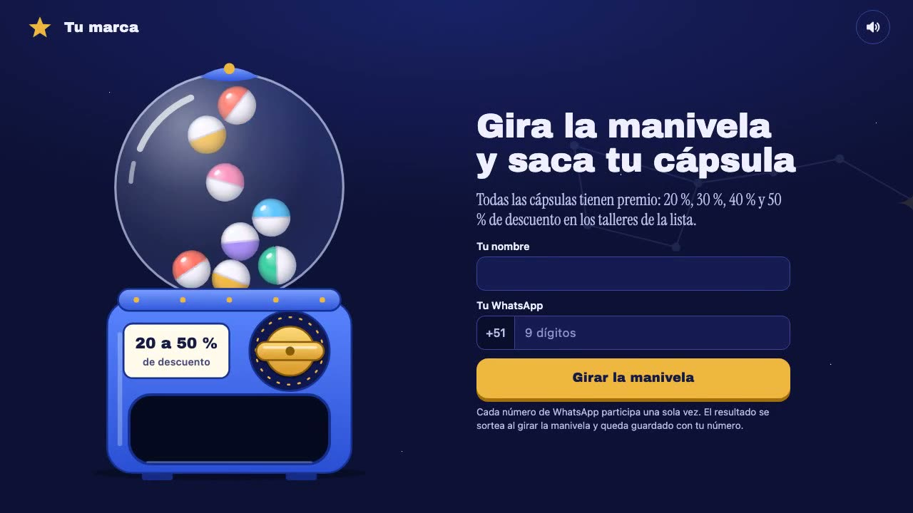
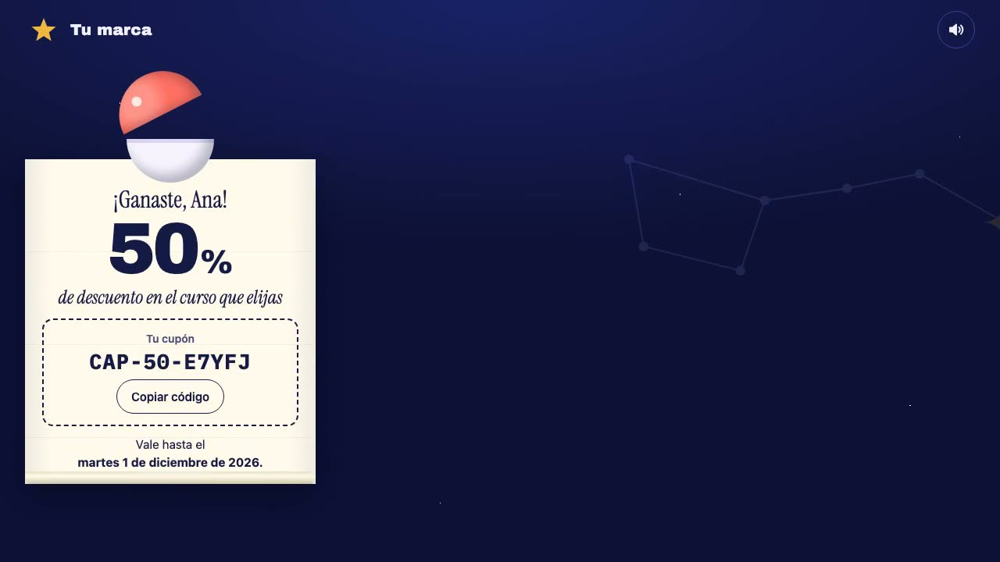

# Gachapon: máquina de cápsulas

Una máquina de cápsulas: la persona gira la manivela, caen tres cápsulas y abre una. El descuento ya estaba decidido en el servidor. Después ve un catálogo de talleres con el precio que pagaría con su cupón y elige uno para reclamarlo por WhatsApp.



## Cómo levantarlo (Windows y Mac)

Con Docker Desktop abierto, en esta carpeta:

```bash
docker compose up -d --build
```

- El sorteo: **http://127.0.0.1:8103**
- El panel: **http://127.0.0.1:8103/admin (escribe la clave en el formulario)**. La clave de ejemplo es `cambia-esta-clave-larga`.
- Para apagarlo: `docker compose down`. Para borrar también los participantes: `docker compose down -v`.

Para usar tu propia clave, copia `.env.example` como `.env` y cámbiala (mínimo 12 caracteres). En
Windows: `copy .env.example .env`; en Mac: `cp .env.example .env`.

## Qué enseña

- **Pesos y topes:** cada descuento sale en proporción a su peso; cuando llega a su tope, su peso se reparte entre los demás (`config.json`).
- **Cupón con vencimiento:** código `CAP-<porcentaje>-XXXXX`, válido los días de `dias_vigencia`.
- **Catálogo:** `cursos.json` y una imagen por curso en `web/brochures/`. El servidor no arranca si falta una imagen.
- **Panel:** buscar, filtrar, marcar cupones como canjeados y descargar un CSV (con protección contra fórmulas de Excel).



## Hazlo tuyo

Cambia los talleres de `cursos.json` y sus imágenes en `web/brochures/` (formato .webp). El número de WhatsApp está en `config.json`.

El prompt que crea este ejemplo está en [PROMPT.md](PROMPT.md).
