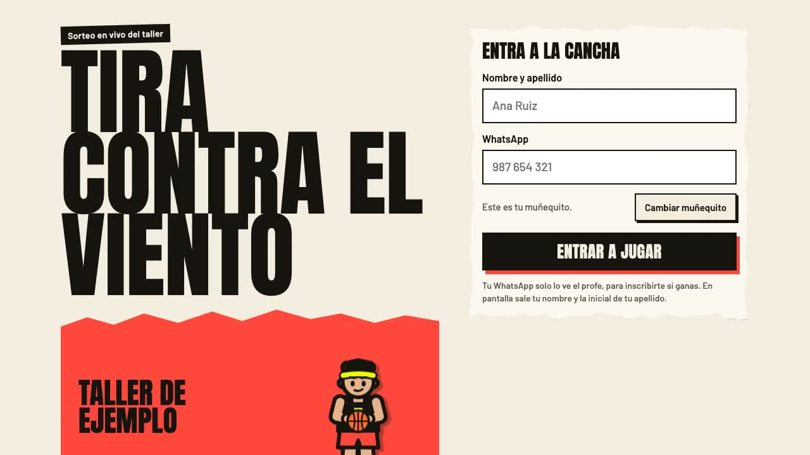
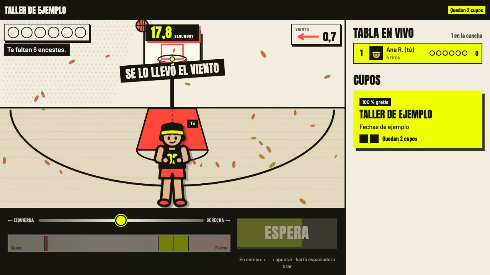

# Canasta con viento (juego de habilidad en vivo)

Un juego de habilidad en vivo: cada persona tiene 25 segundos para meter 6 canastas mientras el viento cambia de dirección y de fuerza. Quien lo logra gana un cupo. La tabla en vivo muestra a todos los jugadores. Cuando el profe pulsa «Cerrar sorteo», entre quienes no ganaron se sortea un premio de consuelo.



## Cómo levantarlo (Windows y Mac)

Con Docker Desktop abierto, en esta carpeta:

```bash
docker compose up -d --build
```

- El sorteo: **http://127.0.0.1:8105**
- El panel: **http://127.0.0.1:8105/admin?k=TU_CLAVE**. La clave de ejemplo es `cambia-esta-clave-larga`.
- Para apagarlo: `docker compose down`. Para borrar también los participantes: `docker compose down -v`.

Para usar tu propia clave, copia `.env.example` como `.env` y cámbiala (mínimo 12 caracteres). En
Windows: `copy .env.example .env`; en Mac: `cp .env.example .env`.

## Qué enseña

- **El servidor es el árbitro:** manda el viento, mide el tiempo de cada tiro y decide si entró. La página solo dibuja.
- **Tiempo real:** una conexión WebSocket por pantalla; la tabla y los cupos se actualizan para todos.
- **El profe controla la ronda:** abrir, pausar, cerrar y reabrir desde el panel.
- **Dificultad en `config.json`:** fuerza máxima del viento, tolerancia del tiro y velocidad del medidor.



## Hazlo tuyo

El juego empieza en pausa: abre el panel y pulsa «Abrir» antes de compartir el enlace.

El prompt que crea este ejemplo está en [PROMPT.md](PROMPT.md).
