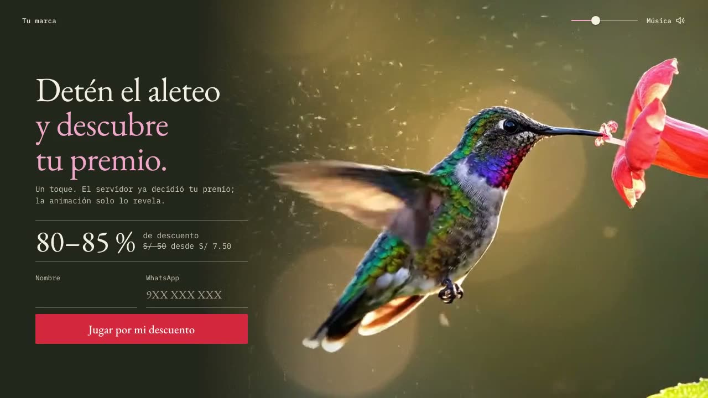
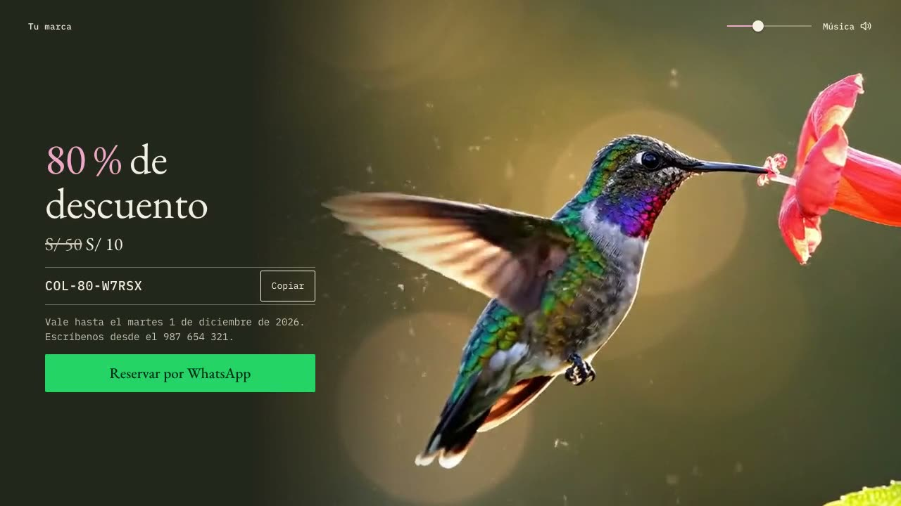

# Detén el aleteo del colibrí

Un sorteo elegante para marcas: un colibrí aletea tan rápido que solo se ve una mancha. La persona toca «Detén el aleteo», el video se congela y aparece su descuento. El toque no cambia el resultado: el servidor ya lo había decidido.



## Cómo levantarlo (Windows y Mac)

Con Docker Desktop abierto, en esta carpeta:

```bash
docker compose up -d --build
```

- El sorteo: **http://127.0.0.1:8106**
- El panel: **http://127.0.0.1:8106/admin (escribe la clave en el formulario)**. La clave de ejemplo es `cambia-esta-clave-larga`.
- Para apagarlo: `docker compose down`. Para borrar también los participantes: `docker compose down -v`.

Para usar tu propia clave, copia `.env.example` como `.env` y cámbiala (mínimo 12 caracteres). En
Windows: `copy .env.example .env`; en Mac: `cp .env.example .env`.

## Qué enseña

- **Pesos y topes:** 80 % (peso 70, tope 40), 85 % (peso 15, tope 10) y sin premio (peso 15).
- **Fecha de fin:** `fin` en `config.json` cierra el sorteo y limita la vigencia de los cupones.
- **Video propio:** `web/video/` trae el colibrí generado con IA. Puedes poner tu música en `web/audio/musica.mp3`.



## Hazlo tuyo

Para tu propia marca, cambia los videos de `web/video/`, el texto de `web/index.html` y los colores de `web/estilos.css`.

El prompt que crea este ejemplo está en [PROMPT.md](PROMPT.md).
